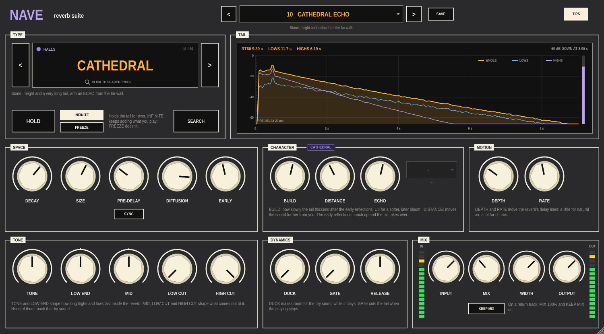

# Nave

A reverb suite for Ableton Live. Twenty-nine reverb types, from a whisper of
room ambience to a cathedral, plates, springs, clouds, shimmer, choirs,
gated and reverse shapes, tape echo and tuned tails, all with the same set of
controls for shaping them, and a display that shows you the actual tail you've
dialled in.

Put it on a track (MIX to taste) or on a return track (MIX at 100%, KEEP MIX
on).



New to Nave? The [Getting started guide](docs/Nave-Getting-Started.pdf) (PDF)
gets it running in Live and shows you round the panel.

## Finding a type

Click the type's name (or **SEARCH**) and type a few letters: a name
(`plate`), a place (`church`), a use (`drums`, `vocal`) or a sound (`dark`,
`80s`, `octave`). The category buttons narrow the list; the arrow keys move,
Return picks and Escape closes. **PRESETS** searches the presets the same way,
factory and your own. `<` `>` beside the type step through them in order.

Picking a type moves SPACE and CHARACTER to where that type sounds best; TONE,
MOTION, DYNAMICS and MIX stay where you left them.

| Category | Types |
| --- | --- |
| **ROOMS** | Ambience, Studio Room, Live Room, Drum Room, Club, Chamber, Reflections |
| **HALLS** | Small Hall, Concert Hall, Arena, Cathedral |
| **PLATES** | Plate, Vocal Plate, Vintage Plate |
| **SPRINGS** | Spring, Surf Spring |
| **AMBIENT** | Cloud, Bloom, Shimmer, Halo, Abyss, Choir, Swell |
| **SPECIAL** | Nonlinear, Gated, Reverse, Tape Echo, Lo-Fi, Resonant |

## What's on the panel

**Header** — PRESET (click for the list or to search, or step with `<` `>`; a
`*` means you've changed it), SAVE, TIPS.

**TYPE** — the type, its category and what it is. **HOLD** stops the tail
decaying: with **INFINITE** what you play keeps adding to it, with **FREEZE**
it's closed off and you play over it.

**TAIL** — the impulse response of the current settings, measured whenever you
change something: the whole tail in amber, its lows in blue and its highs in
lavender, with the decay times (RT60) read from it. The bar on the right is the
reverb playing now.

**SPACE**
- **DECAY** — how long the tail lasts (to fall 60 dB). Each type keeps it in its own range.
- **SIZE** — how big the space is, separately from how long it rings.
- **PRE-DELAY** — a gap before the reverb, up to 1.5 s. **SYNC** sets it in note values at Live's tempo.
- **DIFFUSION** — grainy and echoey to smooth and dense.
- **EARLY** — the first reflections off the nearest walls.

Some types rename these: the tape echo's DECAY and EARLY are its room's
DECAY and level, Reflections' DECAY is its TAIL.

**CHARACTER** — up to three knobs and a choice that belong to the type:

| Type | Knobs | Choice |
| --- | --- | --- |
| Rooms and halls | BUILD, DISTANCE (+ SMASH on Drum Room, ECHO on Cathedral) | |
| Reflections | X, Y, WANDER | SQUARE, RECTANGLE, OBLONG |
| Plates | DRIVE | LARGE, SMALL |
| Springs | DWELL, DRIP | 1, 2 or 3 SPRINGS |
| Cloud | HAZE, SMEAR | |
| Bloom | LENGTH, FEEDBACK | |
| Shimmer, Halo, Abyss | AMOUNT, SHIFT 1, SHIFT 2 | INPUT, TANK, BOTH |
| Choir | RESONANCE, VOICES | AH, OH, OO, EE, AH-OH, OH-OO, RANDOM |
| Swell | RISE, SENSE | WET, DRY |
| Nonlinear, Gated, Reverse | TIME, FEEDBACK, LATE | SWOOSH, REVERSE, RAMP, GATE, GAUSS, BOUNCE |
| Tape Echo | TIME, FEEDBACK, WOW | 1 HEAD, 3/4/6 EVEN, 3/4/6 SCATTER |
| Lo-Fi | CRUSH, WOBBLE, GRIT | |
| Resonant | RING, CHORD | the NOTE it rings on |

With TIPS on, every knob explains itself.

**MOTION** — DEPTH and RATE move the reverb's delay lines: a little for
natural air, a lot for chorus.

**TONE** — TONE (how long the highs last), LOW END (how long the lows last)
shape the reverb from the inside. MID, LOW CUT and HIGH CUT shape what comes
out. None of them touch the dry sound.

**DYNAMICS** — **DUCK** turns the reverb down while you play and lets it bloom
in the gaps. **GATE** cuts it off when the input drops below a level (the
light shows it open). **RELEASE** is how fast both let go.

**MIX** — INPUT, MIX, WIDTH, OUTPUT and meters. At 50% MIX the dry sound and
the reverb are both at full level; past it the dry sound fades out, to 100%
wet. **KEEP MIX** stops presets from changing MIX, for a return track.

Every knob, button and choice is a host parameter, so it can be automated or
MIDI-mapped in Live, HOLD included.

**Presets** — 33 factory presets, two of them made for return tracks. SAVE
writes your own to `~/Library/Application Support/Nave/Presets` (Windows
`%APPDATA%\Nave\Presets`, Linux `~/.config/Nave/Presets`); they show under
YOURS in the list and in the preset search.

## How it works

Every type is a voicing of one of six engines:

- **SPACE** — early reflections, allpass diffusers and a 16-line feedback
  delay network with separate decay times for the lows, mids and highs. The
  rooms, halls and ambient types, with extras for some: long drifting
  diffusers (Cloud), a feedback bloom stage (Bloom), pitch shifters feeding
  the tank (Shimmer, Halo, Abyss), vowel formant filters (Choir), a tuned comb
  bank (Resonant), a far-wall echo (Cathedral).
- **PLATE** — a figure-eight plate tank after the topology Jon Dattorro
  published in 1997.
- **SPRING** — loops of stretched allpass filters, which delay the lows more
  than the highs and give a real spring's falling chirp.
- **REFLECTIONS** — the walls, floor and ceiling of a small room mirrored up to
  fifth order, a few hundred reflections reaching each ear at their own time
  and level, recalculated as the source moves.
- **NONLINEAR** — a dense bank of taps whose levels follow a shape rather than
  a decay, with feedback and a late tail.
- **TAPE** — a tape loop with up to six playback heads, wow and flutter, and
  feedback through the tape's tone, smeared into a small room.

Every type sits at about the same loudness, so switching types compares sounds
rather than levels.

## Building

Needs CMake 3.22+ and a C++20 compiler. JUCE 8.0.9 is downloaded on first
configure.

```sh
cmake -B build -DCMAKE_BUILD_TYPE=Release
cmake --build build --config Release
ctest --test-dir build -C Release
```

The VST3 is copied to `~/Library/Audio/Plug-Ins/VST3` after each build on macOS
(`-DNAVE_COPY_PLUGIN=OFF` to stop that). `-DNAVE_BUILD_TOOLS=ON` also builds
`NaveSnapshot`, which runs Nave without a host, writes the panel to a PNG and
can render every factory preset to WAV files: `NaveSnapshot panel.png wavs
[input.wav]`.

The engine tests check every type's level, peak and stability (including
every knob at both ends, for ten seconds of loud noise), that DECAY matches
the decay measured from the impulse response, pre-delay, HOLD in both modes,
switching types mid-sound, DUCK, GATE, SWELL, block-size and sample-rate
independence, and the type search.

The [Build workflow](.github/workflows/build.yml) builds and tests on macOS,
Windows and Linux when you run it from the Actions tab. Run it on a version tag
(`v0.1.0`) to get a draft release with all three archives attached.

## Licence

Nave is released under the GNU AGPLv3. See [LICENSE](LICENSE).
